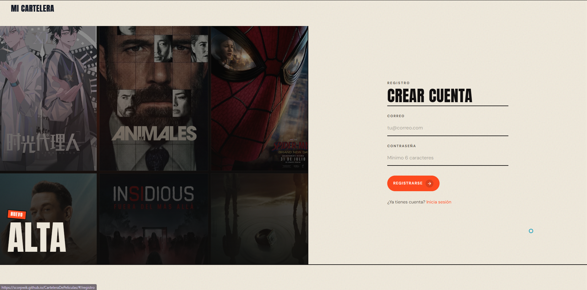

# Mi Cartelera Personal

Aplicación web para llevar una cartelera personal de películas y series. Consume la API de [TMDB](https://www.themoviedb.org/) para buscar títulos reales (póster, sinopsis, elenco y calificación oficial) y cada usuario guarda su propia colección en Supabase, con autenticación y Row Level Security (RLS) para que nadie vea ni modifique la lista de otro.

- **App publicada:** https://scorpwik.github.io/CarteleraDePeliculas/
- **Repositorio:** https://github.com/Scorpwik/CarteleraDePeliculas

## Capturas de pantalla


*Login: acceso con correo y contraseña (Supabase Auth).*



*Registro: alta de cuenta con correo y contraseña (mínimo 6 caracteres).*


*Home: hero de tendencias, búsqueda TMDB y muro de carteles de la semana.*


*Mi lista: filtros por estado, orden por fecha/calificación y contador resumen.*


*Detalle: ficha del título con valoración personal (estado, estrellas y comentario).*

## Tecnologías

| Capa | Tecnología | Uso |
|------|------------|-----|
| Frontend | React 19.2 + TypeScript + Vite 8.3 | SPA tipada y build con `@vitejs/plugin-react` |
| Enrutado | react-router-dom 7.18 (`HashRouter`) | Rutas con hash, compatibles con GitHub Pages (`base: /CarteleraDePeliculas/`) |
| API externa | TMDB v3 | Búsqueda y detalle (`src/lib/tmdb.ts`) |
| Autenticación | Supabase Auth (`@supabase/supabase-js` 2.117) | Registro, login, sesión y logout (`src/context/AuthContext.tsx`) |
| Base de datos | Supabase PostgreSQL + RLS | Tabla `mi_lista` y políticas en `supabase/schema.sql` |
| Animación | GSAP 3.15 + `@gsap/react` 2.1 | Scroll, revelados y microinteracciones |
| Scroll | Lenis 1.3 | Scroll suave (`src/components/LenisRoot.tsx`) |
| Estilos | CSS en `src/index.css` | Diseño visual de la app (sin framework CSS) |

## Requisitos funcionales

1. ✅ **Acceso controlado** — Login y registro en `src/pages/Login.tsx` y `src/pages/Registro.tsx`; rutas privadas envueltas en `RutaProtegida` (`src/components/RutaProtegida.tsx`) y sesión en `AuthContext`.
2. ✅ **Búsqueda en TMDB** — Home/buscador en `src/pages/Buscar.tsx` con `src/lib/tmdb.ts`; estados de carga (`SkeletonPoster`) y error en la misma página.
3. ✅ **Agregar a mi lista** — Persistencia en Supabase vía `src/lib/lista.ts` (tabla `mi_lista`), no en TMDB.
4. ✅ **CRUD completo** — Listar/actualizar/eliminar en `src/pages/MiLista.tsx` y detalle editable en `src/pages/Titulo.tsx`, usando las funciones de `src/lib/lista.ts`.
5. ✅ **Estados tipados** — Unión `'por_ver' \| 'viendo' \| 'vista'` en `src/types.ts` y `check` en `supabase/schema.sql`.
6. ✅ **Calificación 1–5 y comentario** — Estrellas (`src/components/Estrellas.tsx`) y formulario de valoración en `Titulo.tsx`; columna `calificacion_personal` (1–5) y `comentario` en el esquema.
7. ✅ **Página de detalle** — `src/pages/Titulo.tsx` en modos `editable` (`/titulo/:id`) y `lectura` (`/explorar/:tipo/:tmdbId`), con datos TMDB (sinopsis, elenco, etc.).
8. ✅ **Seguridad con RLS** — Cuatro políticas en `supabase/schema.sql` (`select`/`insert`/`update`/`delete`) con `auth.uid() = user_id`.

**Extras implementados**

- Filtro por estado y orden por fecha/calificación en `MiLista.tsx`.
- Contador resumen (`ContadorAnimado` + totales en `MiLista.tsx`).
- Publicación en GitHub Pages (`.github/workflows/deploy.yml`, `base` en `vite.config.ts`).

## Instalación y uso

1. **Requisitos previos:** Node.js 18+, cuenta en [Supabase](https://supabase.com/) y API key v3 de [TMDB](https://www.themoviedb.org/settings/api).

2. Clonar el repositorio e instalar dependencias:

```bash
git clone https://github.com/Scorpwik/CarteleraDePeliculas.git
cd CarteleraDePeliculas
npm install
```

3. Crear `.env` a partir de `.env.example` con estas variables:

```env
VITE_SUPABASE_URL=
VITE_SUPABASE_ANON_KEY=
VITE_TMDB_API_KEY=
```

| Variable | Dónde obtenerla |
|----------|-----------------|
| `VITE_SUPABASE_URL` | Supabase → Project Settings → API → Project URL |
| `VITE_SUPABASE_ANON_KEY` | Supabase → Project Settings → API → `anon` `public` |
| `VITE_TMDB_API_KEY` | TMDB → Settings → API → API Key (v3 auth) |

4. **Configurar Supabase**
   - Ejecutar el contenido de `supabase/schema.sql` en el SQL Editor.
   - Para pruebas locales: Authentication → Providers → Email → desactivar **Confirm email**.

5. Arrancar en desarrollo:

```bash
npm run dev
```

Abre http://localhost:5173 (puerto por defecto de Vite).

6. Scripts disponibles:

| Script | Comando | Descripción |
|--------|---------|-------------|
| Desarrollo | `npm run dev` | Servidor Vite |
| Build | `npm run build` | `tsc -b` + `vite build` |
| Preview | `npm run preview` | Vista previa del build |
| Lint | `npm run lint` | ESLint |

**Seguridad:** usa solo la clave `anon`; nunca la `service_role` en el frontend. El archivo `.env` no se sube al repositorio (está en `.gitignore`).

## Base de datos

Tabla `public.mi_lista` (según `supabase/schema.sql`):

| Columna | Tipo | Notas |
|---------|------|--------|
| `id` | `bigint` identity | PK |
| `user_id` | `uuid` | `default auth.uid()`, FK a `auth.users` |
| `tmdb_id` | `integer` | ID en TMDB |
| `titulo` | `text` | |
| `poster_url` | `text` | |
| `tipo_contenido` | `text` | `'pelicula'` \| `'serie'` |
| `estado` | `text` | `'por_ver'` \| `'viendo'` \| `'vista'` |
| `calificacion_personal` | `integer` | `null` o 1–5 |
| `comentario` | `text` | |
| `fecha_agregado` | `timestamptz` | `default now()` |

Restricción única: `(user_id, tmdb_id, tipo_contenido)`.

**Políticas RLS** (rol `authenticated`):

| Política | Operación | Condición |
|----------|-----------|-----------|
| `mi_lista_select_own` | SELECT | `auth.uid() = user_id` |
| `mi_lista_insert_own` | INSERT | `auth.uid() = user_id` |
| `mi_lista_update_own` | UPDATE | `auth.uid() = user_id` |
| `mi_lista_delete_own` | DELETE | `auth.uid() = user_id` |

`user_id` lo asigna la base con `default auth.uid()`; el frontend no filtra por usuario en las consultas: RLS limita las filas visibles y modificables.

**Verificación con dos cuentas:** se inicia sesión con el usuario A, se agregan títulos y se confirma que aparecen en Mi lista; luego se cierra sesión y se entra con el usuario B: la lista de A no se ve y B solo opera sobre sus propias filas.

## Rutas

La app usa `HashRouter` (`src/App.tsx`), por lo que las URLs en GitHub Pages son del tipo `/#/ruta`.

| Ruta | Pantalla | Acceso |
|------|----------|--------|
| `/login` | `Login` | Público |
| `/registro` | `Registro` | Público |
| `/` | `Buscar` (home) | Protegido (`RutaProtegida`) |
| `/mi-lista` | `MiLista` | Protegido |
| `/titulo/:id` | `Titulo` (`modo="editable"`) | Protegido |
| `/explorar/:tipo/:tmdbId` | `Titulo` (`modo="lectura"`) | Protegido |
| `*` | Redirección a `/` | — |

## Estructura del proyecto

```text
cartelera/
├── .github/workflows/deploy.yml
├── .env.example
├── package.json
├── vite.config.ts
├── supabase/schema.sql
├── docs/capturas/          # capturas del README
└── src/
    ├── App.tsx
    ├── main.tsx
    ├── index.css
    ├── types.ts
    ├── pages/              # Login, Registro, Buscar, MiLista, Titulo
    ├── components/         # Layout, UI, animaciones, RutaProtegida…
    ├── context/            # AuthContext
    ├── hooks/
    └── lib/                # supabase.ts, tmdb.ts, lista.ts, …
```

## Despliegue

Publicación en GitHub Pages mediante Actions (`.github/workflows/deploy.yml`):

1. En el repositorio: **Settings → Secrets and variables → Actions**, crear:
   - `VITE_SUPABASE_URL`
   - `VITE_SUPABASE_ANON_KEY`
   - `VITE_TMDB_API_KEY`
2. **Settings → Pages → Source:** GitHub Actions.
3. En Supabase → Authentication → URL Configuration: Site URL y Redirect URLs con `https://scorpwik.github.io/CarteleraDePeliculas/`.
4. Push a `main` (o `workflow_dispatch`) ejecuta build (`vite` con `base: '/CarteleraDePeliculas/'`) y despliega el artefacto `dist`.

URL: https://scorpwik.github.io/CarteleraDePeliculas/

## Créditos y licencias

This product uses the TMDB API but is not endorsed or certified by TMDB.  
https://www.themoviedb.org/

Tipografías (Google Fonts, `index.html`): **Anton**, **DM Sans**, **Instrument Serif**.
