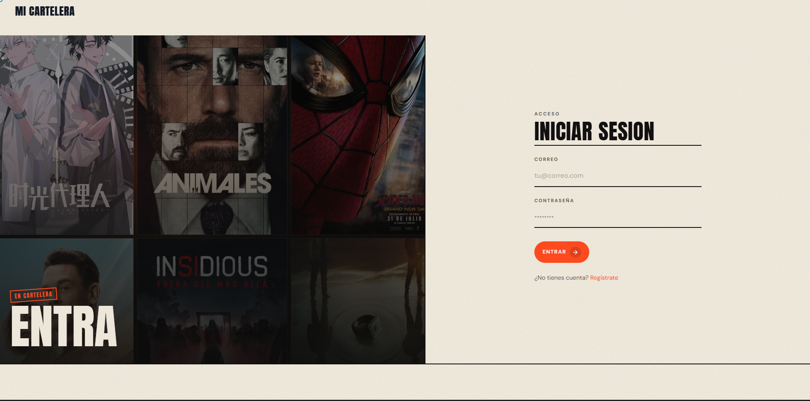
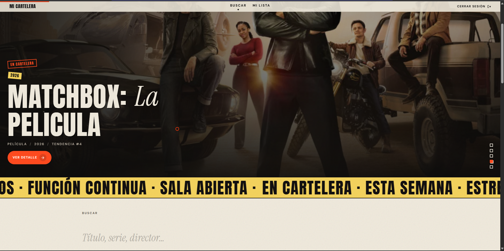
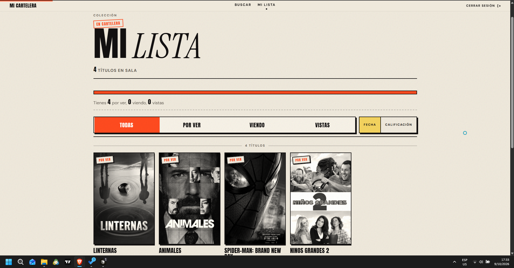
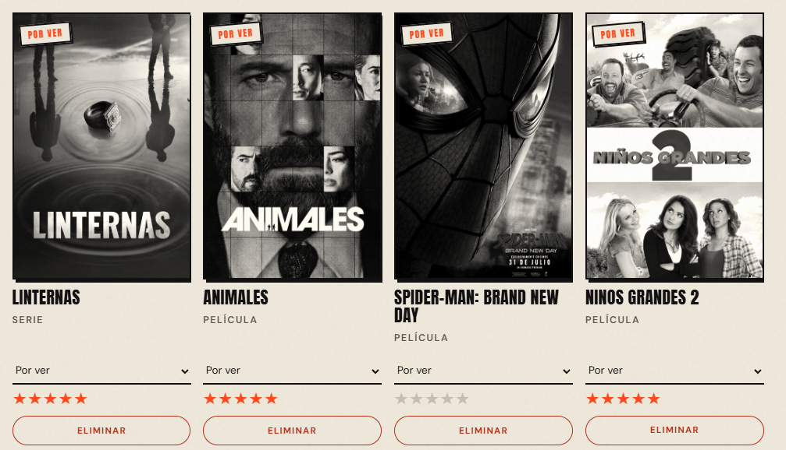

# Mi Cartelera Personal

Aplicación web para buscar películas y series (TMDB), guardarlas en una lista personal y llevar el seguimiento de su estado, calificación y comentarios. La autenticación y la persistencia se gestionan con Supabase; el aislamiento de datos por usuario se aplica con Row Level Security (RLS).

## Tecnologías

- React + TypeScript (Vite)
- React Router
- Supabase (Auth + Postgres + RLS)
- API TMDB v3
- CSS plano (`src/index.css`)

## Instalación

```bash
npm install
```

Crea un archivo `.env` a partir de `.env.example` y completa las variables:

```env
VITE_SUPABASE_URL=
VITE_SUPABASE_ANON_KEY=
VITE_TMDB_API_KEY=
```

> Nunca uses la clave `service_role` en el frontend. Solo la clave anónima (`anon` / publishable).

Arranca el servidor de desarrollo:

```bash
npm run dev
```

## Esquema de la tabla `mi_lista`

```sql
create table public.mi_lista (
  id uuid primary key default gen_random_uuid(),
  user_id uuid not null default auth.uid() references auth.users (id) on delete cascade,
  tmdb_id integer not null,
  tipo_contenido text not null check (tipo_contenido in ('pelicula', 'serie')),
  titulo text not null,
  poster_path text,
  estado text not null default 'por_ver' check (estado in ('por_ver', 'viendo', 'vista')),
  calificacion_personal integer check (
    calificacion_personal is null
    or (calificacion_personal between 1 and 5)
  ),
  comentario text,
  created_at timestamptz not null default now(),
  unique (user_id, tmdb_id, tipo_contenido)
);
```

## Políticas RLS

```sql
alter table public.mi_lista enable row level security;

create policy "mi_lista_select_own"
  on public.mi_lista
  for select
  to authenticated
  using (auth.uid() = user_id);

create policy "mi_lista_insert_own"
  on public.mi_lista
  for insert
  to authenticated
  with check (auth.uid() = user_id);

create policy "mi_lista_update_own"
  on public.mi_lista
  for update
  to authenticated
  using (auth.uid() = user_id)
  with check (auth.uid() = user_id);

create policy "mi_lista_delete_own"
  on public.mi_lista
  for delete
  to authenticated
  using (auth.uid() = user_id);
```

El cliente no filtra por `user_id`: la seguridad la garantiza RLS. En los `insert`, `user_id` lo asigna la base de datos con `auth.uid()`.

## App publicada

[URL de la app publicada — placeholder]

## Capturas de pantalla

### Login



### Buscador



### Mi lista



### Detalle


