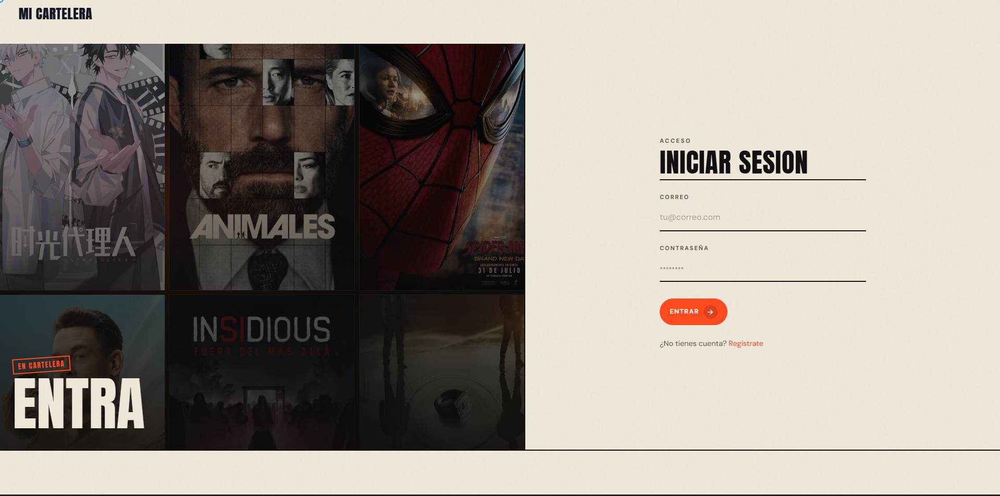
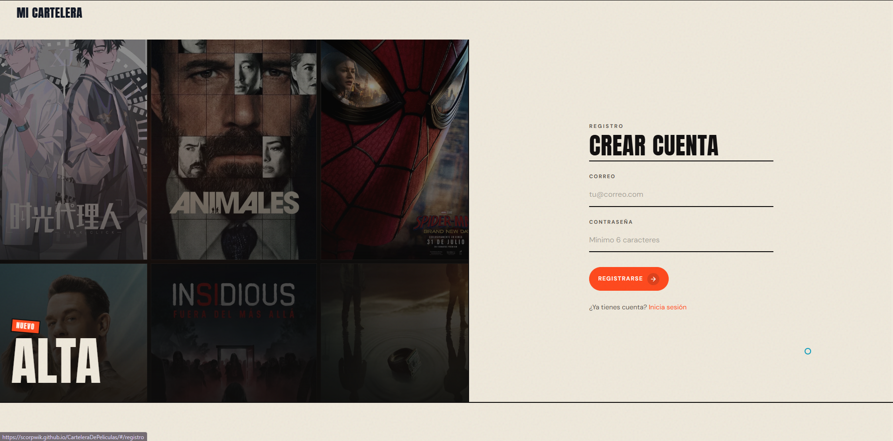
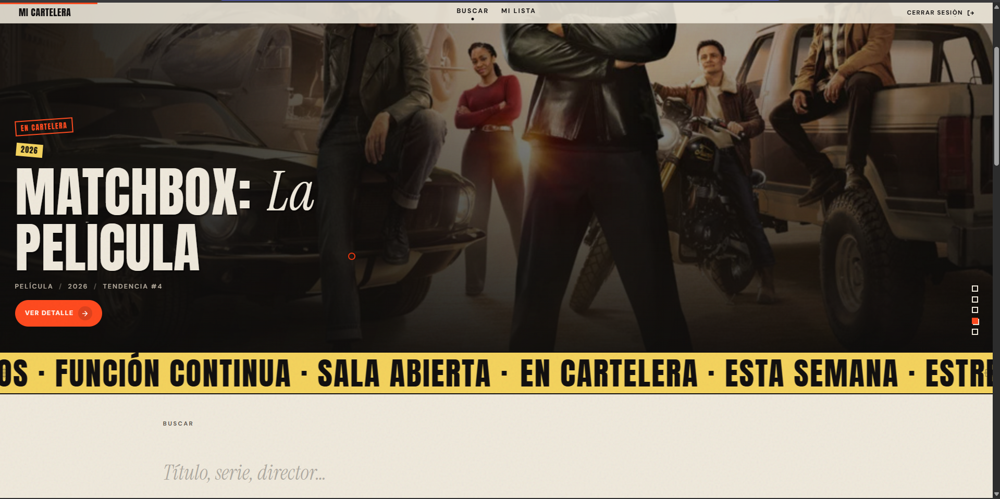
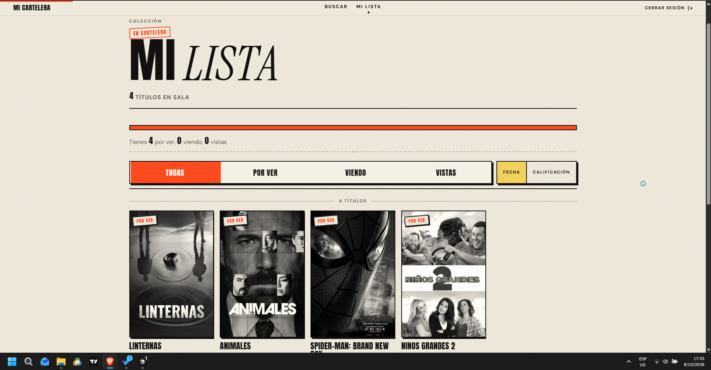
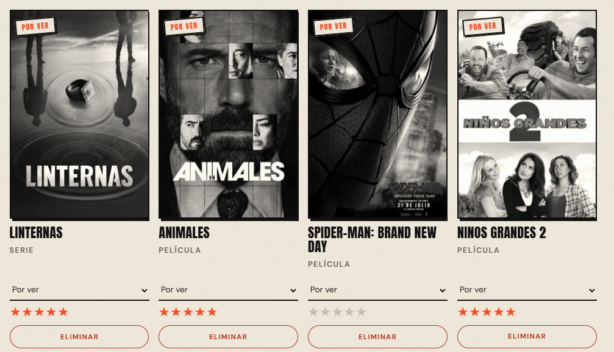

# Mi Cartelera Personal

Mi Cartelera Personal es una aplicación para armar tu propia cartelera de películas y series. Buscas títulos reales en TMDB (póster, sinopsis, elenco y calificación oficial), los guardas en tu cuenta y les pones estado, estrellas del 1 al 5 y un comentario. Supabase Auth identifica la sesión y las políticas RLS de Postgres hacen que cada persona solo vea y edite lo suyo. Si tienes un rato libre, Noche de película te muestra qué películas «por ver» caben en esos minutos, con la duración que trae TMDB, y te deja armar la tanda (10 minutos de pausa entre títulos) y guardarla sin cambiar el estado de las películas.

**Demo:** https://scorpwik.github.io/cartelera-de-peliculas/

**Repositorio:** https://github.com/Scorpwik/cartelera-de-peliculas

## Capturas



_Inicio de sesión con correo y contraseña._



_Registro de cuenta (contraseña de al menos 6 caracteres)._



_Inicio: tendencias de la semana, búsqueda en TMDB y muro de carteles._



_Mi lista: filtro por estado, orden y contador._



_Ficha del título, con estado, estrellas y comentario._

## Funciones

- Registro e inicio de sesión con correo y contraseña (`src/pages/Registro.tsx`, `src/pages/Login.tsx`). Las rutas privadas pasan por `RutaProtegida`.
- Búsqueda de películas y series en TMDB, con carga y error en la misma pantalla, y tendencias de la semana en el inicio (`src/pages/Buscar.tsx`, `src/lib/tmdb.ts`).
- Lista personal en Supabase: agregar, actualizar y eliminar (`src/lib/lista.ts`, `src/pages/MiLista.tsx`). El estado es `por_ver`, `viendo` o `vista`.
- Calificación personal del 1 al 5 y comentario en la ficha del título (`src/pages/Titulo.tsx`).
- Ficha en modo edición (`/titulo/:id`) o solo lectura desde el catálogo (`/explorar/:tipo/:tmdbId`).
- Filtro por estado, orden por fecha o calificación, y contador de la lista.
- Noche de película (`/#/noche`): indicas entre 30 y 600 minutos, ves qué películas por ver caben y guardas la sesión en Supabase (`src/dominio/sesion.ts`, `src/lib/sesiones.ts`). Guardar no cambia el estado de las películas. La regla de «cabe» está cubierta con Vitest (`npm test`).

## Stack

| Capa       | Tecnología                      | Dónde                                                                     |
| ---------- | ------------------------------- | ------------------------------------------------------------------------- |
| Interfaz   | React 19 + TypeScript + Vite    | SPA; `base` de Vite: `/cartelera-de-peliculas/`                           |
| Rutas      | react-router-dom (`HashRouter`) | `src/App.tsx`. Sin `basename`: el hash va después de la ruta del proyecto |
| Catálogo   | TMDB API v3                     | `src/lib/tmdb.ts`. Imágenes en `https://image.tmdb.org/t/p/w500`          |
| Cuentas    | Supabase Auth                   | `src/lib/supabase.ts`, `src/context/AuthContext.tsx`                      |
| Datos      | Supabase Postgres + RLS         | `mi_lista`, `sesiones`, `sesion_peliculas`                                |
| Movimiento | GSAP y Lenis                    | Scroll y microinteracciones                                               |
| Estilos    | CSS propio                      | `src/index.css` y `DESIGN.md`. Sin Bootstrap                              |

## Cómo correrla en tu computadora

Necesitas Node.js 20 o superior, una cuenta en [Supabase](https://supabase.com/) y una clave de la API v3 de [TMDB](https://www.themoviedb.org/settings/api).

```bash
git clone https://github.com/Scorpwik/cartelera-de-peliculas.git
cd cartelera-de-peliculas
npm install
```

Copia `.env.example` a `.env` y completa las tres variables (sin subir ese archivo: está en `.gitignore`).

En el SQL Editor de Supabase ejecuta `supabase/schema.sql` y, para Noche de película, `supabase/sesiones.sql`. Para probar en local, en Authentication → Providers → Email desactiva **Confirm email**.

```bash
npm run dev
```

Abre http://localhost:5173/cartelera-de-peliculas/ . Vite publica la app bajo `base`, así que la raíz `http://localhost:5173/` no es la pantalla de inicio.

| Comando           | Qué hace                         |
| ----------------- | -------------------------------- |
| `npm run dev`     | Servidor de desarrollo           |
| `npm run build`   | `tsc -b` y `vite build`          |
| `npm run preview` | Vista previa del build           |
| `npm run lint`    | ESLint                           |
| `npm test`        | Vitest, regla de «cabe», sin red |

## Harness del agente

La épica E2 es Noche de película: con un rato de 30 a 600 minutos, la app muestra qué películas «por ver» caben, arma la tanda (10 minutos de pausa) y la guarda sin cambiar el estado. La spec está en `docs/specs/e2-noche-de-pelicula.md` y la regla de «cabe» en `src/dominio/sesion.ts`.

Para correr las pruebas y el lint:

```bash
npm test
npm run lint
```

`npm test` ejecuta Vitest, sin red ni base de datos. `npm run lint` ejecuta ESLint.

El agente no escribe funcionalidad nueva sin spec. Esas reglas viven en `AGENTS.md`. `CLAUDE.md` no añade reglas: importa `@AGENTS.md`. Los commits los pide la persona con la skill `/commit`, en `.claude/skills/commit/`, con `disable-model-invocation: true`. Después de cada Write o Edit, el hook `PostToolUse` de `.claude/settings.json` formatea el archivo tocado con Prettier. Ese hook no reformatea `src/index.css`.

## Variables de entorno

Ningún valor secreto va en el repositorio ni en este README. En el frontend solo se usa la clave `anon`; nunca la `service_role`.

```env
VITE_SUPABASE_URL=
VITE_SUPABASE_ANON_KEY=
VITE_TMDB_API_KEY=
```

| Variable                 | Para qué sirve            | Dónde la consigues                        |
| ------------------------ | ------------------------- | ----------------------------------------- |
| `VITE_SUPABASE_URL`      | URL del proyecto Supabase | Project Settings → API → Project URL      |
| `VITE_SUPABASE_ANON_KEY` | Clave pública `anon`      | Project Settings → API → `anon` `public`  |
| `VITE_TMDB_API_KEY`      | Consultas a TMDB v3       | TMDB → Settings → API → API Key (v3 auth) |

En GitHub Actions los mismos tres nombres son secrets del repositorio (Settings → Secrets and variables → Actions). El workflow (`.github/workflows/deploy.yml`) no trae valores escritos.

## Panel de Supabase (fuera de este repositorio)

El login y el registro no fijan una URL de retorno: `signInWithPassword` y `signUp` no envían `emailRedirectTo`. La dirección de vuelta la define el panel de Supabase.

En **Authentication → URL Configuration** actualiza a mano:

- **Site URL:** `https://scorpwik.github.io/cartelera-de-peliculas/`
- **Redirect URLs:** `https://scorpwik.github.io/cartelera-de-peliculas/`

Si vas a confirmar el correo desde tu computadora, agrega también `http://localhost:5173/cartelera-de-peliculas/`.

Ese cambio no está en el código ni en git. Si el panel sigue con la ruta anterior de GitHub Pages, la confirmación de correo y cualquier redirección de Auth van a fallar, porque esa ruta ya no existe.

## Rutas

Con `HashRouter`, en la demo las pantallas quedan así: `https://scorpwik.github.io/cartelera-de-peliculas/#/ruta`.

| Ruta                      | Pantalla          | Acceso     |
| ------------------------- | ----------------- | ---------- |
| `/login`                  | Inicio de sesión  | Público    |
| `/registro`               | Registro          | Público    |
| `/`                       | Buscador          | Con sesión |
| `/mi-lista`               | Mi lista          | Con sesión |
| `/titulo/:id`             | Ficha editable    | Con sesión |
| `/explorar/:tipo/:tmdbId` | Ficha de lectura  | Con sesión |
| `/noche`                  | Noche de película | Con sesión |

## Despliegue

GitHub Pages sale de Actions al hacer push a `main` o con `workflow_dispatch`. El job hace el build con `base: '/cartelera-de-peliculas/'` y publica la carpeta `dist`. En el repositorio, Settings → Pages → Source tiene que ser **GitHub Actions**.

La demo queda en https://scorpwik.github.io/cartelera-de-peliculas/

## Base de datos

`public.mi_lista` (`supabase/schema.sql`): `id`, `user_id` (por defecto `auth.uid()`), `tmdb_id`, `titulo`, `poster_url`, `tipo_contenido` (`pelicula` | `serie`), `estado` (`por_ver` | `viendo` | `vista`), `calificacion_personal` (vacío o 1–5), `comentario`, `fecha_agregado`. Único `(user_id, tmdb_id, tipo_contenido)`. RLS de select, insert, update y delete solo si `auth.uid() = user_id`.

Noche de película usa `supabase/sesiones.sql` (`sesiones` y `sesion_peliculas`) y no altera las columnas de `mi_lista`.

## Créditos

This product uses the TMDB API but is not endorsed or certified by TMDB.  
https://www.themoviedb.org/

Tipografías (Google Fonts, `index.html`): Anton, DM Sans e Instrument Serif.
